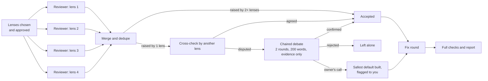

# review-with-chaired-debate

A Claude Code skill for reviewing a branch with several agents at once. Independent reviewers each read the change through one **lens**. Their findings are merged and cross-checked. Any finding the reviewers disagree on goes to a short **chaired debate**, which decides it on evidence. Everything that survives is fixed before you open the pull request.

The result is a branch that has already been reviewed and fixed, with a short report of what was found, what was argued, and what changed.

## Why

- **One reviewer misses things.** Reviewers with different lenses (correctness, security, tests, standards) catch different defects. The skill also works well with custom lenses, such as payments or architecture.
- **Several reviewers disagree.** Instead of keeping every finding, or quietly dropping the ones that sound weak, the skill gives each contested finding a fixed, evidence-only hearing.
- **Debates drift unless they are bounded.** Each one has two sides, two rounds and at most 200 words per turn. Every claim must cite `file:line`, a traced code path, or a test that was actually run. A chair rules on the evidence, not on who argued more confidently.

## How it works



1. **Pin the inputs:** the worktree, the diff base, and the spec the change was meant to meet.
2. **Choose the lenses.** Four by default, and you can swap any of them. The skill shows you each lens and its focus, and waits for your approval or revisions before any reviewer starts.
3. **Review.** Each reviewer works alone and read-only. It marks every finding CONFIRMED (traced) or PLAUSIBLE, with evidence. It also lists what it checked and found sound.
4. **Merge and cross-check.**
   - Duplicate findings are merged.
   - A finding raised by two or more lenses is accepted.
   - A finding raised by one lens is checked by a reviewer from another lens.
5. **Debate the contested findings.** A finding is contested when its checker disagrees, gives no answer, or rates it two or more severities lower. Each one gets the two-round debate and a ruling: **confirmed**, **rejected**, or **owner's call**. An owner's call is a product choice the spec doesn't settle; the safest reversible default is built and flagged to you.
6. **Fix.** A fix file points at every finding by id, adds any binding decisions, and goes to the agent that built the code. Every behavior change gets a test.
7. **Verify and report.**
   - The full checks run on the fixed branch: typecheck, lint, the test suite twice, and the build.
   - The report lists the counts, every medium-or-worse finding and its fix, each debate ruling, the owner's calls, and the behavior changes.

## Requirements

- [Claude Code](https://claude.com/claude-code) with subagents and the **Workflow** tool for multi-agent workflows. Invoking the skill counts as your opt-in to that run.
- The branch to review checked out in a git worktree (or the main checkout).
- A spec the change should meet: a plan file, an issue, or a precise sentence.

## Install

Unzip or copy the folder into your user skills directory:

```text
~/.claude/skills/review-with-chaired-debate/
├── SKILL.md      # the steps Claude follows
├── workflow.js   # the multi-agent orchestration
└── README.md     # this file
```

To share it with one project instead, put the folder in that project's `.claude/skills/`.

## Use

Type the command, or just ask for a multi-agent review:

```text
/review-with-chaired-debate the payments branch against origin/main; spec in docs/plans/payments.md
```

Claude pins the inputs, proposes the lenses for your approval, runs the review in the background, and then drives the fix round and the final checks.

### Inputs

| Key | Meaning |
|---|---|
| `worktree` | Absolute path of the worktree holding the branch. |
| `base` | The diff base (default `origin/main`). To review only new work on an already-reviewed branch, use the last reviewed commit. |
| `what` | One line naming the change. |
| `spec` | What the change was meant to do (binding). |
| `tests` | Optional: where reviewers may run targeted tests or read-only queries. Without it, they run nothing that writes. |
| `standards` | Optional: docs beyond `CLAUDE.md` / `AGENTS.md` to hold the code to. |
| `lenses` | Optional: `[{ key, focus }]`. The defaults are correctness, security, tests and standards. |
| `checkerOf` | Optional: which lens cross-checks each lens's single-source findings. By default it's the next lens in the list. |

### Lens ideas

- **money:** payment-provider behavior, double or missed charges, proration, idempotency, webhooks out of order.
- **architecture:** did a refactor actually deepen its modules; old pieces deleted rather than layered over; no remaining copies of a rule.
- **migrations:** each one additive and safe while the previous version still serves.
- **accessibility, performance or i18n** for front-end-heavy changes.

## Cost and scale

A run uses about 4 reviewers, 1 merge agent, up to 4 checkers, and 5 agents for each contested finding. That is typically 10 to 30 agents, and a run with nothing contested skips the debate entirely. For a small pull request, a single reviewer, or two reviewers and an arbiter, is the better fit. Save this skill for big builds and for refactors of code that matters.

## Guarantees

- **Reviewers are read-only.** They never edit, commit, stash, reset or push, and never open `.env` files or print secrets.
- **Nothing is dropped silently.** Every finding ends up accepted, rejected with reasons, or flagged as an owner's call. The full result, including the debate transcripts and the "found sound" lists, is saved as JSON.
- **You stay in control of the review's scope:** the lenses run only after you approve them.
